<p align="center">
  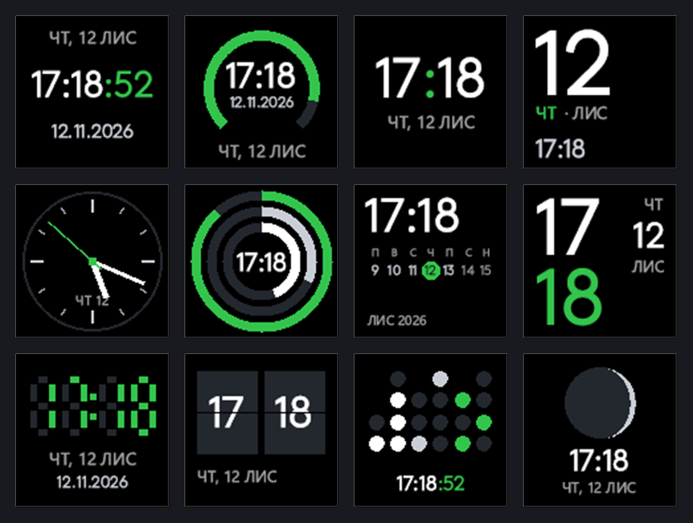
</p>

<p align="center">
  <a href="https://github.com/GavryschukOleg/MonthCalendar/releases"></a>
  <a href="LICENSE"></a>
  
  <a href="https://paypal.me/donicteck"></a>
</p>

# ClockCalendar

A plugin for the **Logitech MX Creative Console** (and other Logi Plugin Service devices) that puts a **clock and a month calendar** on a single key, in twelve designs. Tap the key to switch between the clock and the month.

It uses the same flat dark look as the [HardwareMonitor](https://github.com/GavryschukOleg/HardwareMonitor) plugin, so the keys of both plugins look like one family.

## Features

- **Two views on one key** - the clock with the date, and the whole month; tap to switch.
- **Twelve designs** - digital, analog, rings, LED segments, flip cards, binary dots, the moon and more. Put one on a key, or several on different keys.
- **Two editions of every design** - a regular one (24-hour clock, system language, `dd.MM.yyyy`) and an AM/PM one (12-hour clock, English, `MM/dd/yyyy`), kept in two separate folders of the action list.
- **Fits the key** - text is measured and fitted to the key size, long month names fall back to abbreviations.
- **Lightweight** - no settings, no network access, no background services. The package is under 50 KB.

## Designs

Every image below is the plugin's own drawing output rendered at the real key sizes, not a mockup. Each design is a clock view (left) and a month view (right). The regular editions are in the **Clock Calendar** group of the action list, the AM/PM editions in **Clock Calendar (AM/PM)**.

### Classic

The default design: the weekday and date, the time with green seconds, and the full date. Today is a green disc in the month.

Actions: `Classic`, `Classic (AM/PM)`

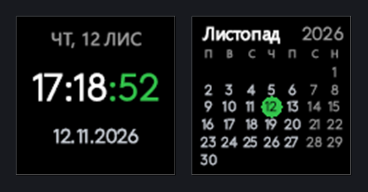

### Ring

The time inside a ring that fills over the minute, like the Ring cards of HardwareMonitor. Today is a green ring in the month.

Actions: `Ring`, `Ring (AM/PM)`

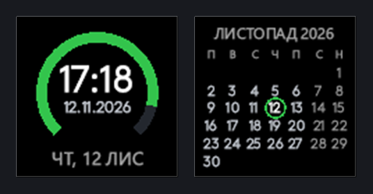

### Minimal

Just the time with a blinking green colon and a quiet date line. The month is a bare grid with today in green.

Actions: `Minimal`, `Minimal (AM/PM)`

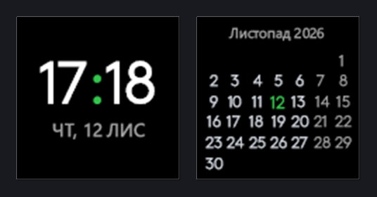

### Date

The day of the month first, the time under it. Nothing changes every second, so the key refreshes once a minute. Today is a dark square in the month.

Actions: `Date`, `Date (AM/PM)`

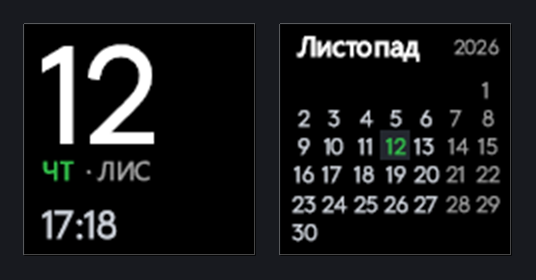

### Analog

An analog dial with hour marks, white hour and minute hands, a thin green seconds hand, and the date inside.

Actions: `Analog`, `Analog (AM/PM)`

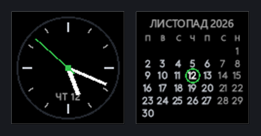

### Orbit

Three concentric rings: the seconds in green outside, the minutes in the middle, the hours inside, with the time in the center.

Actions: `Orbit`, `Orbit (AM/PM)`

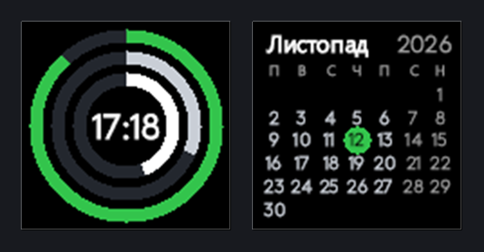

### Week

The time and the current week as a strip of days with today in green. In the month view the current week is highlighted. Refreshes once a minute.

Actions: `Week`, `Week (AM/PM)`

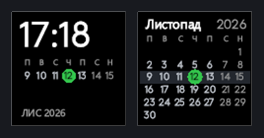

### Stack

Typographic: the hours in white over the minutes in green, with the weekday, the day and the month in a narrow column. Refreshes once a minute.

Actions: `Stack`, `Stack (AM/PM)`

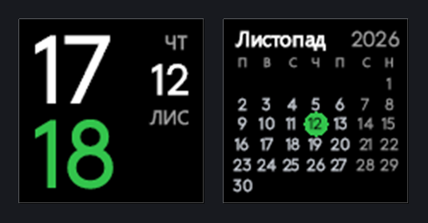

### Segment

A seven-segment LED display: lit segments in green over faint unlit ones, with a blinking colon.

Actions: `Segment`, `Segment (AM/PM)`

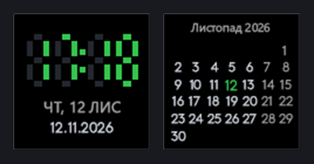

### Flip

Flip-clock cards: the hours and the minutes on two dark cards split by a thin line. Refreshes once a minute.

Actions: `Flip`, `Flip (AM/PM)`

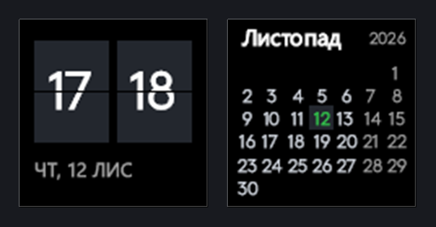

### Binary

A binary-coded clock: every digit of the time is a column of dots (8-4-2-1). Hours are white, minutes light, seconds green; the digital time is under the dots.

Actions: `Binary`, `Binary (AM/PM)`

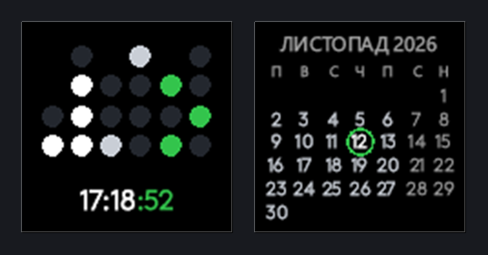

### Moon

Today's moon phase, computed from the date and drawn as seen from the northern hemisphere, with the time and the date under it. Refreshes once a minute.

Actions: `Moon`, `Moon (AM/PM)`

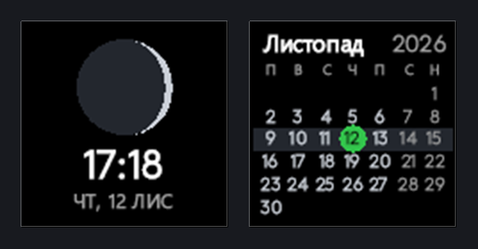

### Colors

The palette is shared with HardwareMonitor.

| Color | RGB | Used for |
| --- | --- | --- |
| White | `255, 255, 255` | time, important numbers |
| Light gray | `201, 206, 214` | dates, days of the month |
| Gray | `158, 158, 158` | titles, weekends |
| Track | `35, 39, 46` | empty part of the bars and rings |
| Green | `51, 196, 76` | the one accent: seconds, today |

## Requirements

- Windows 10 or 11, or macOS. One package works on both.
- Logi Options+ (it ships the Logi Plugin Service the plugin runs in).
- A Logitech MX Creative Console, Loupedeck CT / Live / Live S, or Razer Stream Controller (X).

## Installation

1. Download `ClockCalendar_1_1_1.lplug4` from the [Releases](https://github.com/GavryschukOleg/MonthCalendar/releases) page.
2. Double-click the file, or install it from a terminal:

   ```powershell
   logiplugintool install ./ClockCalendar_1_1_1.lplug4
   ```

3. In Logi Options+ open the **Clock Calendar** group (or **Clock Calendar (AM/PM)**) and drag an action onto a key.

## Troubleshooting

| Problem | What to do |
| --- | --- |
| The actions do not show up after installing | Fully quit Logi Options+ (from the tray icon on Windows, the menu bar icon on macOS) and start it again. |
| The language is not the one you want | The plain actions follow the language of the operating system. Use the AM/PM editions (the **Clock Calendar (AM/PM)** group) for English. |
| The month is hard to read on a small key | On 50 px keys the month grid is very dense. The 80 px and 116 px keys show it comfortably. |
| The clock stopped updating | Tap the key. If it ever happens again, please open an issue and attach `MonthCalendar.log` from `%LOCALAPPDATA%\Logi\LogiPluginService\Logs\plugin_logs` (Windows) or `~/Library/Application Support/Logi/LogiPluginService/Logs/plugin_logs` (macOS). |

## Building from source

You need the [.NET 10 SDK](https://dotnet.microsoft.com/download), Logi Options+ (the plugin is built against the libraries of the Logi Plugin Service), and the `logiplugintool` .NET tool (`dotnet tool install --global logiplugintool`).

```powershell
dotnet build -c Release
logiplugintool pack ./bin/Release ./ClockCalendar.lplug4
logiplugintool verify ./ClockCalendar.lplug4
```

A build also links the plugin into the Logi Plugin Service and reloads it, so changes show up on the device right away.

## Support the project

If you like the plugin, you can support its development:

<a href="https://paypal.me/donicteck"></a>

## License

[MIT](LICENSE)
